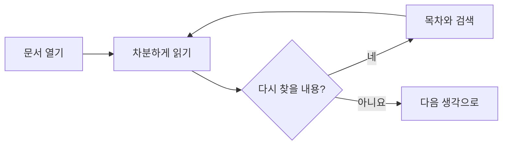
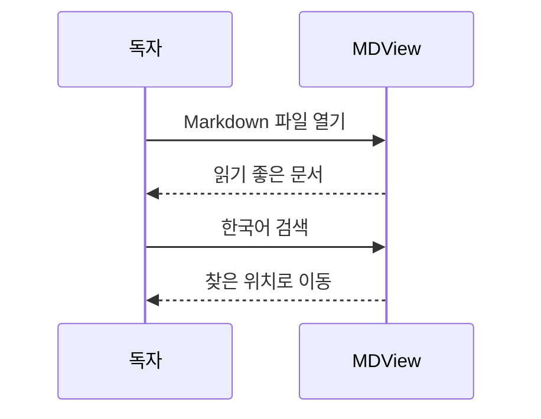

# 생각을 읽기 좋은 모양으로

Markdown은 단순한 텍스트지만, 읽는 경험까지 단순할 필요는 없죠.
**MDView**는 문서의 구조와 여백을 살려, 내용에 집중할 수 있게 합니다.

> 문서는 그대로 두고, 읽는 방식만 편안하게.

## 편안하게 읽기

- 왼쪽 **목차**에서 원하는 장으로 이동하세요.
- `⌘ F`로 문서 안의 단어를 찾으세요. 한국어도 자연스럽게 검색됩니다.
- 상단 **A− / A+** 로 글자 크기를 조절하세요.
- **시스템 · 라이트 · 다크** 중 편안한 테마를 고르세요.

### 작은 체크리스트

- [x] 한국어 문서 열기
- [x] 표와 코드 읽기
- [x] 오프라인 도식 보기
- [ ] 나만의 문서 가져오기

## 한눈에 보는 정보

| 기능 | 방법 | 원문 변경 |
| :--- | :--- | :---: |
| 파일 열기 | ⌘ O 또는 드래그 앤 드롭 | 없음 |
| 목차 | 제목을 자동으로 정리 | 없음 |
| 검색 | ⌘ F, 다음 결과 ⌘ G | 없음 |
| 테마 | 시스템 / 라이트 / 다크 | 없음 |

## 코드는 코드답게

```swift
struct ReadingMoment {
    let title = "천천히, 선명하게"
    let distractions = 0

    func begin() {
        print("반가워요, MDView!")
    }
}
```

긴 코드와 표는 가로로 스크롤할 수 있어 문서 전체의 폭을 흐트러뜨리지 않습니다.

## 생각의 흐름



### 대화도 도식으로



## 안전한 작은 공간

MDView는 문서를 수정하지 않습니다. 원문에 들어 있는 HTML과 스크립트는 실행하지 않으며, 원격 이미지는 자동으로 내려받지 않습니다.

일반 이미지는 이 문서와 같은 폴더 또는 하위 폴더에 두고 상대 경로로 연결하세요. 외부 링크는 확인 후 기본 브라우저에서 엽니다.

[처음으로 돌아가기](#생각을-읽기-좋은-모양으로)

---

**이제, 당신의 문서를 읽어 보세요.**
